<p align="center">
  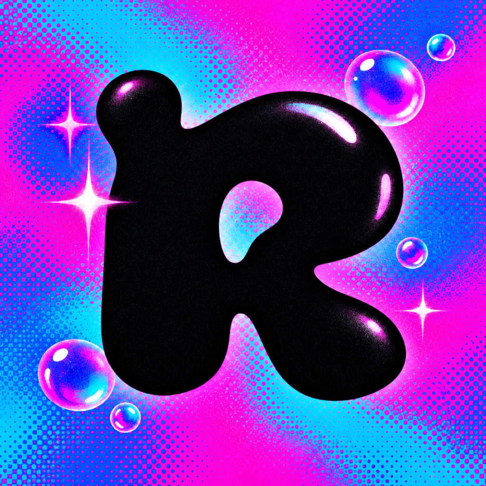
</p>

<h1 align="center">RAVE LIVE</h1>

<p align="center">
  <b>A festival light show that plays along with whatever your Mac is playing.</b><br>
  Beat-locked stage lights, lasers, LED walls, pyro and 33 visualizers. Native Swift and Metal, no account, no tracking.
</p>

<p align="center">
  <a href="https://github.com/jedbrnth-eng/rave-live/actions/workflows/ci.yml"></a>
  
  
  
  <a href="LICENSE"></a>
</p>

<p align="center">
  <a href="#what-it-does">Features</a> ·
  <a href="#photosensitivity-warning">Safety</a> ·
  <a href="#controls">Controls</a> ·
  <a href="#how-it-works">How it works</a> ·
  <a href="#privacy-and-permissions">Privacy</a> ·
  <a href="#build-from-source">Build</a>
</p>

<p align="center">
  <a href="docs/demo.mp4">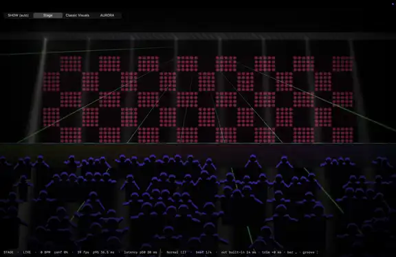</a><br>
  <sub>Stage mode following a 128 BPM track, recorded full screen on a MacBook Pro. <a href="docs/demo.mp4">Watch in full quality</a>.</sub>
</p>

> **Status: pre-release (0.4).** No release has been published yet; build it from source in about a minute (below). Issues and pull requests are welcome.

---

## Photosensitivity warning

RAVE LIVE uses flashing lights and strobes. A small share of people can have seizures from flashing lights. The app shows this warning on first launch, and **strobes are limited to 3 flashes per second by default**. Lifting the limit (`Shift`+`S`) asks for confirmation every time. If you or anyone watching has photosensitive epilepsy, turn strobes off with `S`.

## What it does

Play music in any app (Spotify, Apple Music, YouTube, Serato, a DJ controller on line-in) and RAVE LIVE turns it into a light show. It finds the tempo, the beat and the bar line in real time, then schedules every light cue on that grid, so builds and drops land where the music puts them.

<p align="center">
  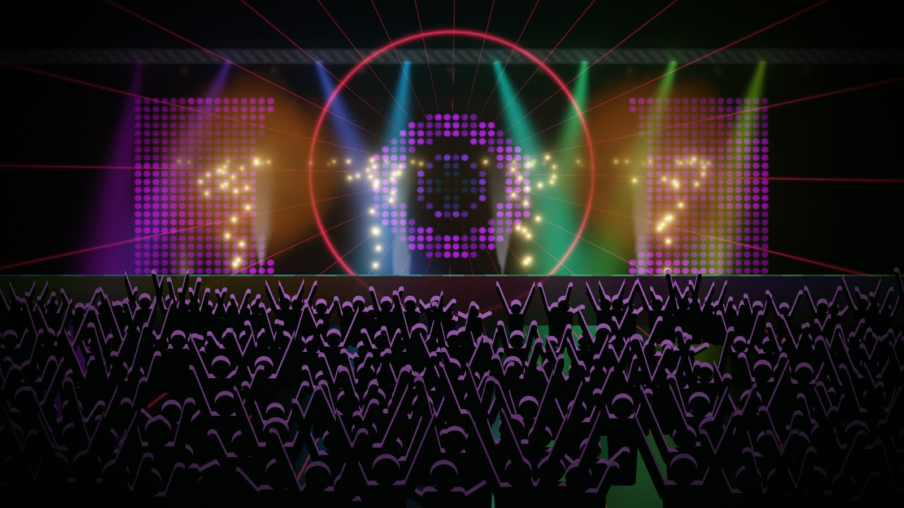
</p>

| Mode | What you get |
|---|---|
| **SHOW** (default) | One continuous set. Moves between Stage, Classic Visuals and AURORA every 32 beats on a bar line, with 7 beat-locked transitions. Drops get a hard cut. |
| **Stage** | A procedural club stage: LED wall looks, moving heads, lasers, haze, flame jets, fireballs and a crowd that reacts. A show director picks looks per phrase and tracks builds and drops. |
| **Classic Visuals** | 33 presets, from feedback classics (Tunnel, MilkWarp, Kaleido) to Synthwave, Galaxy, Neon City, Terrain, reaction-diffusion Coral, a rippling Pond, Fireworks and touchable Silk aurora curtains. Presets 23–32 react to your mouse or hands, and every preset pulses on the shared beat clock. |
| **AURORA** | A GPU fluid simulation with about a million particles and bloom. Stir it with the mouse, or turn on the camera and paint it with your hands and body. |

<table>
  <tr>
    <td>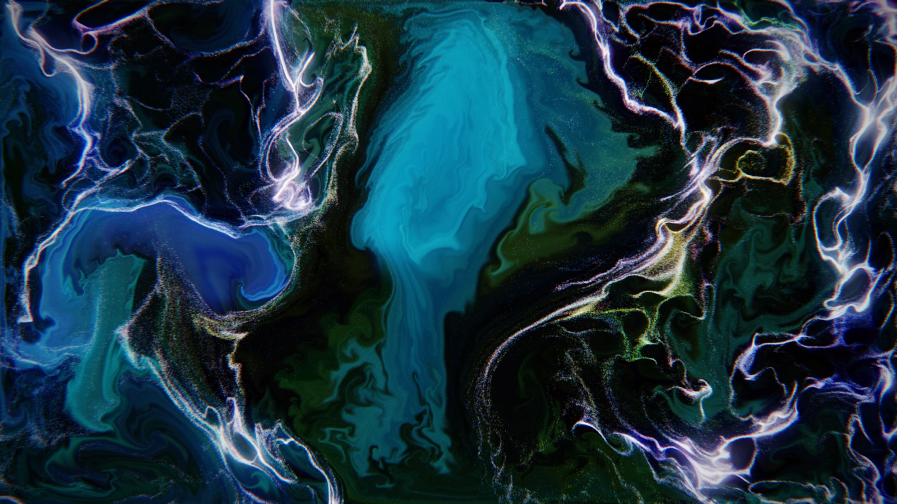</td>
    <td>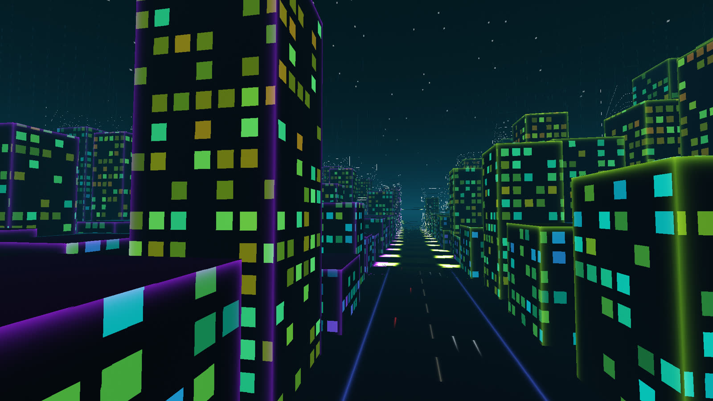</td>
    <td>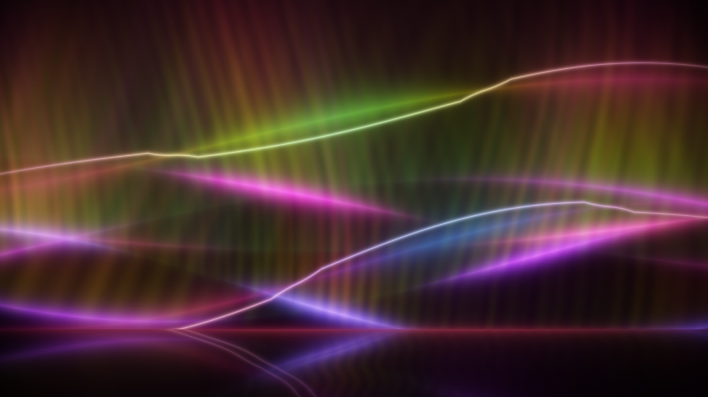</td>
  </tr>
  <tr>
    <td>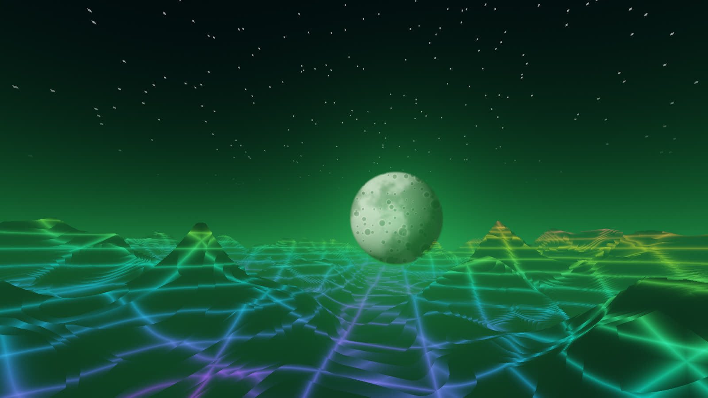</td>
    <td>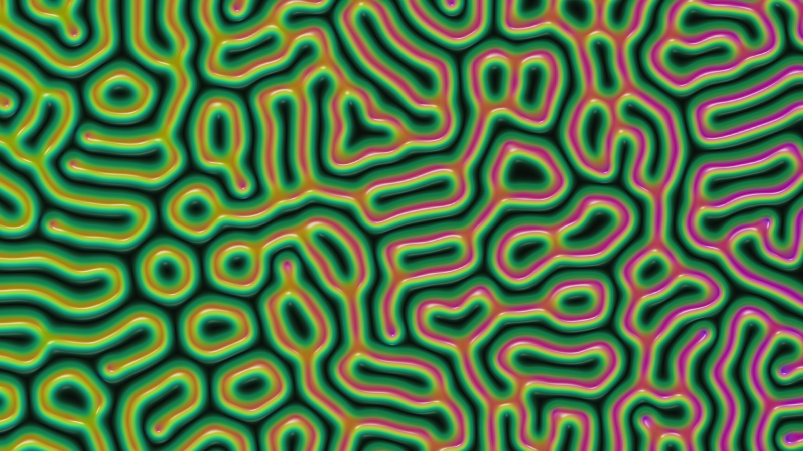</td>
    <td>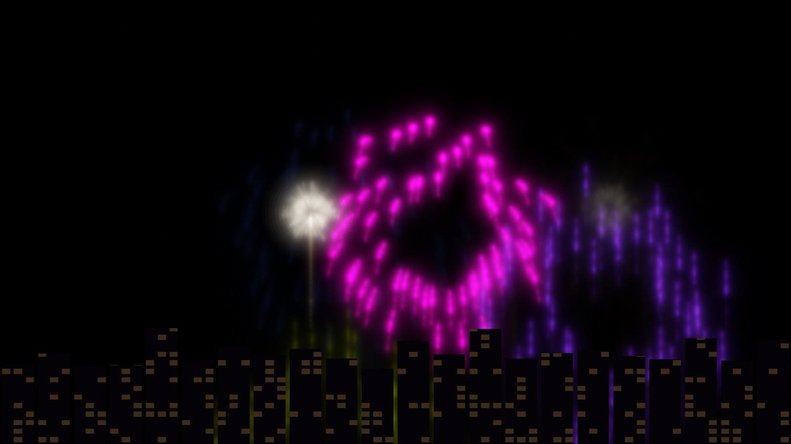</td>
  </tr>
</table>

<sub>All images are unedited frames rendered by the app (version 0.4, demo track).</sub>

### Every visual in motion

<p align="center">
  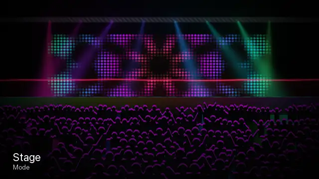
</p>

<sub>Stage, all 33 Classic Visuals presets and AURORA, about a second each. Frames were captured by the app itself (`--demo --snap`) from its built-in synthetic 128 BPM signal, so no music is involved; only the name captions were added afterwards.</sub>

<details>
<summary>Contact sheet of all 35 looks</summary>

<p align="center">
  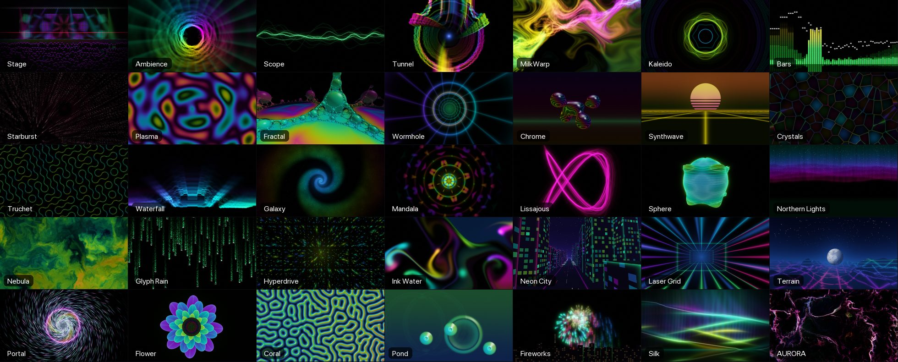
</p>

</details>

## Controls

| Key | Action |
|---|---|
| `⌘1` … `⌘4` or `V` | SHOW / Stage / Classic Visuals / AURORA (or cycle) |
| `1`–`8`, `[` `]` | Pick a preset (Classic Visuals); `1`–`4` pick the stage in Stage mode |
| `A` | Auto-cycle presets on/off |
| `I` | Intensity: Chill / Normal / Wild |
| `T` | Tap tempo |
| `←` `→` (`Shift` for bigger steps) | Nudge the beat phase |
| `,` `.` | Move the visuals 10 ms earlier / later (speaker latency) |
| `S` / `Shift`+`S` | Strobes on/off / lift the 3-per-second limit (asks first) |
| `B` | Blackout |
| `C` or `⌘K` | Camera hands and body (AURORA) |
| `M` | Switch between system audio and microphone / line-in |
| `F` or `⌘F` | Fullscreen |
| `H` | Show or hide the status bar |

<p align="center">
  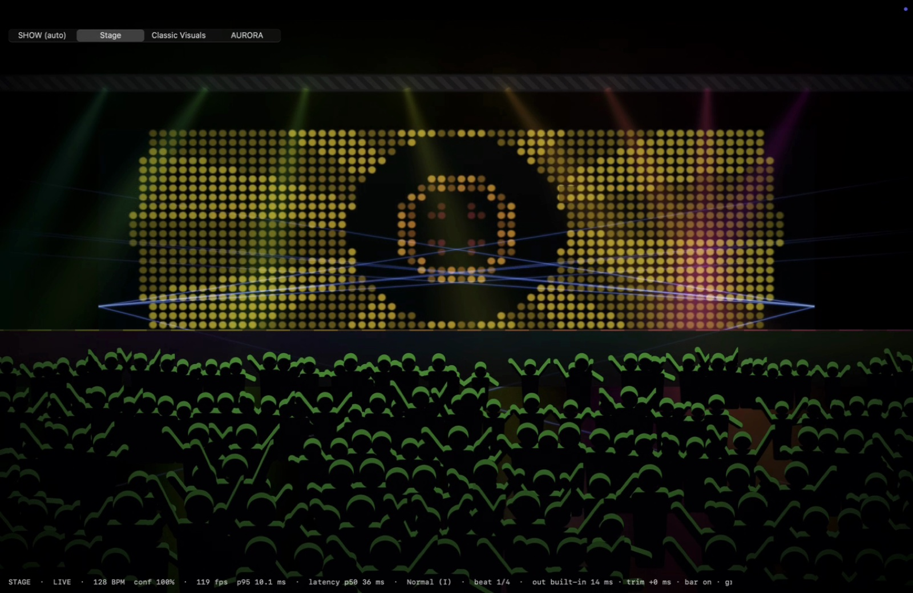
</p>

## How it works

```
system audio (ScreenCaptureKit) ─┐
mic / line-in (AVAudioEngine) ───┴─► LiveAnalyzer ─► TempoTracker ─► ShowDirector ─► Metal renderers
                                     FFT bands,       tempo, beat      phrases,        Stage · Classic
                                     onsets, kick/    phase, bar       build/drop      Visuals · AURORA
                                     snare/hat        line             detection       + transitions
                                                         ▲
                                     Beat This! referee ─┘ (optional Python sidecar)
```

- **Real-time beat tracking.** `RaveAudio` splits the audio into frequency bands, detects onsets with spectral flux and picks kicks, snares and hats. A rolling 8-second autocorrelation finds the tempo, and a phase-locked beat clock predicts the next beat. Guards keep it from locking onto half, double or 3:2 tempos.
- **An optional referee.** Every 1.5 seconds the last 12 seconds of audio go to [Beat This!](https://github.com/CPJKU/beat_this) (CPJKU, ISMIR 2024) in a Python sidecar. It runs in the background and corrects off-beat phase, the tempo level and where beat 1 of the bar falls. The app runs without it.
- **On the beat, on screen.** Beat phase is evaluated at draw time, and the app measures how long frames take to reach the display and compensates for it. It also compensates for the audio output latency.
- **Rendering.** Each mode is a set of Metal shaders compiled at launch. AURORA runs a stable-fluids solver, a particle system and MPS bloom. Camera tracking uses Apple's Vision framework on the Mac.

## Performance

Measured with the app's built-in metrics (`--metrics`) on an Apple M4 Max MacBook Pro (120 Hz built-in display), 1920×1080, using the synthetic 128 BPM demo track:

| Mode | Frame rate | GPU time p95 |
|---|---|---|
| Stage | 108 fps | 4.4 ms |
| Classic Visuals (Neon City) | 107 fps | 3.9 ms |
| Classic Visuals (Fireworks) | 121 fps | 2.5 ms |
| Classic Visuals (Silk) | 108 fps | 3.8 ms |
| AURORA | 120 fps | 6.2 ms |

Frame rate is the last few seconds of a 40-second run, and the display caps it at 120. Draw-to-photon time was about 29–32 ms (p50). The strobe limiter never allowed more than 1 flash per second in these runs. These are demo-mode numbers on one high-end Mac; real music and slower Macs will differ.

## Privacy and permissions

RAVE LIVE has no account, analytics or telemetry, and the app makes no network requests.

| Permission | Why |
|---|---|
| **Screen Recording** | macOS requires it to read the audio your Mac is playing. RAVE LIVE does not record your screen. |
| **Microphone** | Only if you switch to mic or line-in (`M`), for turntables, a mixer or when system audio is unavailable. |
| **Camera** | Only if you turn on hands and body tracking in AURORA. Frames are analysed on your Mac and never saved or sent. |

The optional Beat This! referee is a separate Python install. The `beat_this` package downloads its own model checkpoint from its authors the first time it runs.

## Build from source

Needs macOS 14 or later and Xcode (the full app, because the icon is compiled with `actool`).

```bash
git clone https://github.com/jedbrnth-eng/rave-live.git
cd rave-live
swift test                       # runs the tempo-tracking test suite
scripts/make_app.sh              # creates build/RAVE LIVE.app
open "build/RAVE LIVE.app"
```

`make_app.sh` signs with your "Apple Development" identity if you have one, and ad-hoc otherwise. With ad-hoc signing macOS asks for the audio permission again after each rebuild. The app is not notarized.

Try it with no music playing:

```bash
open -n "build/RAVE LIVE.app" --args --demo          # synthetic 128 BPM track
open -n "build/RAVE LIVE.app" --args --demo --visuals --preset 24
```

<details>
<summary><b>Optional: the Beat This! referee</b></summary>

<br>

```bash
python3.11 -m venv tools/.venv
tools/.venv/bin/pip install numpy torch "git+https://github.com/CPJKU/beat_this"
```

Rebuild the app and it finds `tools/.venv` and `tools/referee.py` in the folder it was built from. To keep them somewhere else, set `RAVE_REFEREE_DIR` (or `RAVE_REFEREE_PYTHON` and `RAVE_REFEREE_SCRIPT`). Without the referee the app works the same, with slightly slower corrections.

</details>

## Testing

- `swift test` runs the `RaveAudioTests` suite: tempo lock on six drum styles (house, drum and bass, boom bap, rock, metal, techno), fast re-lock after a tempo change, beats landing on kicks, silence, tap tempo, rhythmless audio (a past crash), and the referee's gate that rejects irregular beat reports.
- CI runs on every push and pull request: release build, tests, the synthetic-pattern probe, an ad-hoc-signed app bundle, and a check that no personal file paths are committed.
- `.build/release/rave-probe synth` checks the tracker against deterministic drum patterns, and `rave-probe file <audio> <bpm>` against a real track.
- `scripts/bench.py` benchmarks tempo lock time against BPM values you supply as a JSON list of `[path, bpm, genre]` (for example exported from a DJ library): `scripts/bench.py [clip_start_s] <tracks.json>`. No track list or per-track results ship with the repo. `tools/eval_sync.py` scores beat phase against Beat This! ground truth. Both need your own audio files; no music is stored in this repo.
- Visual changes are checked by rendering fixed timestamps with `--demo --snap t1,t2,… --metrics run.json` and comparing the frames.

## Project layout

```
Sources/
├── RaveAudio/      capture, analyzer, tempo tracker, Beat This! referee client, synth test signals
├── RaveLiveApp/    app, show director, Metal renderers and shaders, hand tracking
└── RaveProbe/      rave-probe command-line harness
Tests/RaveAudioTests/
scripts/            make_app.sh, bench.py, shader compile check, live sync test
tools/              referee.py, ground-truth and sync-evaluation scripts
```

## Credits

Beat This! by CPJKU (MIT), the solver structure from Pavel Dobryakov's WebGL-Fluid-Simulation (MIT), and techniques by Inigo Quilez and Karl Sims, re-implemented. Full list and licences in [`CREDITS.md`](CREDITS.md).

## License

[MIT](LICENSE) © 2026 Jed Brown. Third-party work is credited in [`CREDITS.md`](CREDITS.md).
