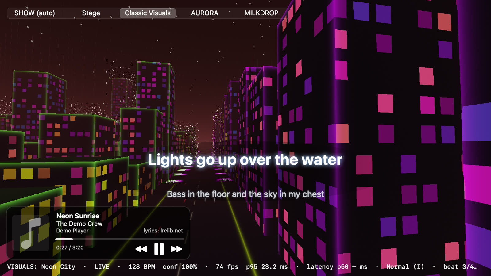
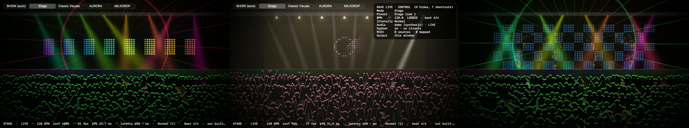
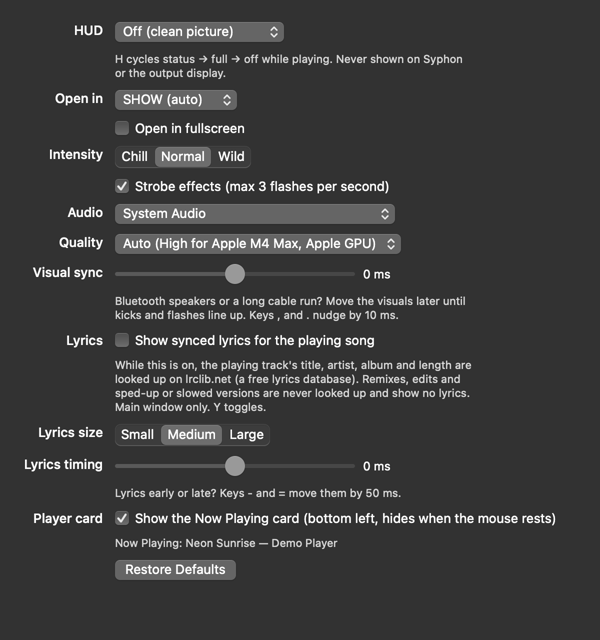
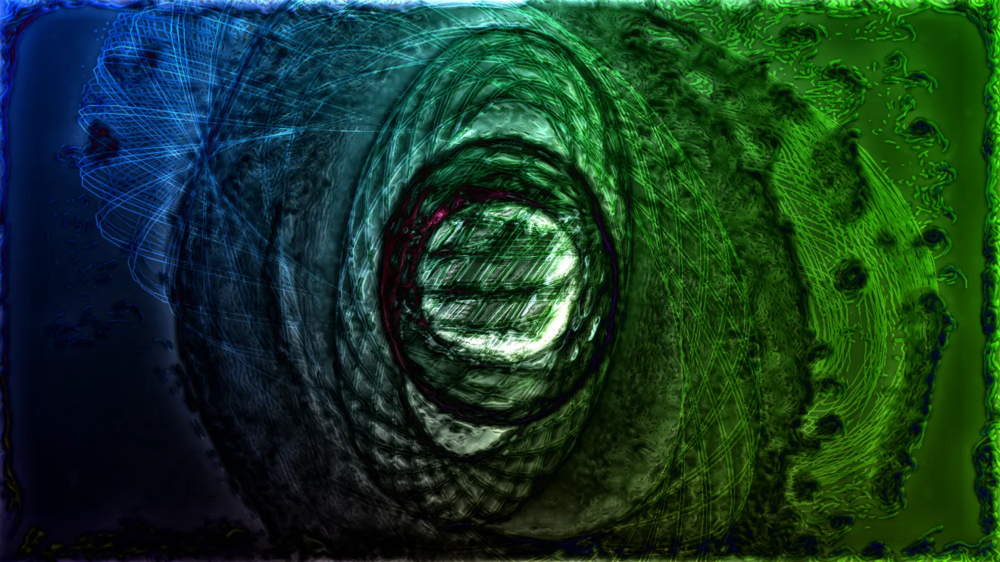
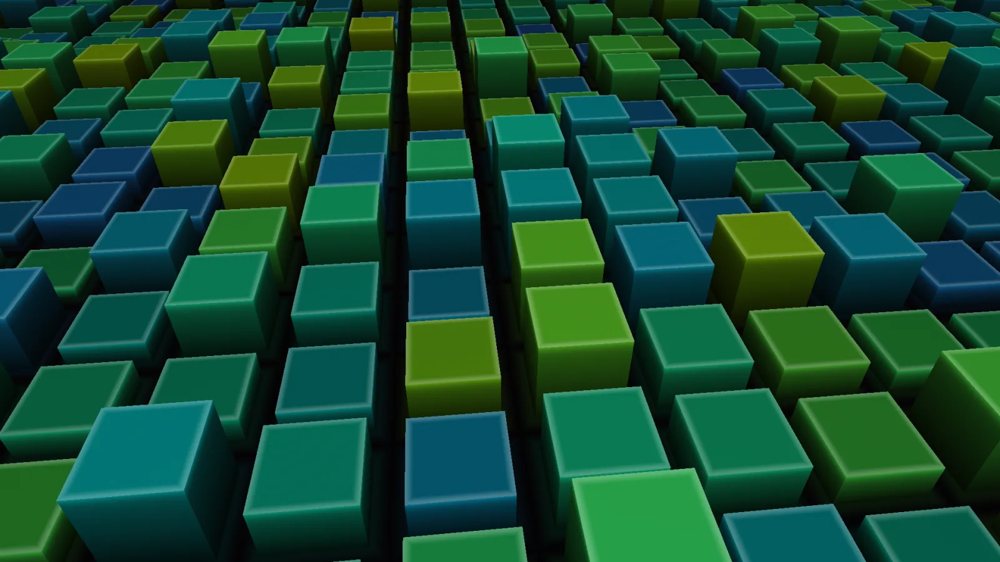

<p align="center">
  
</p>

<h1 align="center">RAVE LIVE</h1>

<p align="center">
  <b>A festival light show that plays along with whatever your Mac is playing.</b><br>
  Beat-locked stage lights, lasers, LED walls, pyro and 48 original visuals, plus 149 MilkDrop presets built in, ~9,800 more one click away, and drag-and-drop for your own. Native Swift and Metal, no account, no tracking.
</p>

<p align="center">
  <a href="https://github.com/jedbrnth-eng/rave-live/actions/workflows/ci.yml"></a>
  
  
  
  <a href="LICENSE"></a>
</p>

<p align="center">
  <a href="#download-no-terminal-needed">Download</a> ·
  <a href="#what-it-does">Features</a> ·
  <a href="#photosensitivity-warning">Safety</a> ·
  <a href="#controls">Controls</a> ·
  <a href="#how-it-works">How it works</a> ·
  <a href="#privacy-and-permissions">Privacy</a> ·
  <a href="#build-from-source">Build</a>
</p>

<p align="center">
  <br>
  <sub>Every look in one reel: Stage, all 48 Classic Visuals presets, AURORA and six of the 149 built-in MilkDrop presets, about a second each. Frames captured by the app itself from its built-in synthetic 128 BPM signal, with name captions added afterwards.</sub>
</p>

> **Status: pre-release.** The latest download is **0.5.1**. **0.6.0** (synced lyrics, a Now Playing card and a performance and robustness pass) is finished and merged on `main` but **not released yet**: build from source to try it, or wait for the 0.6.0 download. Expect rough edges. Issues and pull requests are welcome.

> **Platform: Mac only, Linux/Windows planned.** RAVE LIVE is written for macOS (Swift, Metal and Apple's audio capture), so it does not run on Linux or Windows yet. A cross-platform version is planned; there is no date. Follow along or help in the issues.

---

<p align="center">
  <a href="https://github.com/jedbrnth-eng/rave-live/releases/latest/download/RAVE-LIVE.dmg"></a><br>
  <sub>Free · Apple silicon and Intel · macOS 12+ · about 8 MB · version 0.5.1</sub>
</p>

## Download (no Terminal needed)

1. Click the big **Download RAVE LIVE for Mac** button above. A file called `RAVE-LIVE.dmg` lands in your Downloads folder.
2. Double-click it, then drag **RAVE LIVE** onto the **Applications** shortcut in the window that opens.
3. Open RAVE LIVE from Applications. macOS will say it can't verify the app, because RAVE LIVE isn't notarized by Apple yet. Click **Done**, open **System Settings → Privacy & Security**, scroll down and click **Open Anyway** next to RAVE LIVE, then confirm. You only do this once.
4. Allow **Screen & System Audio Recording** when macOS asks. It is how RAVE LIVE hears what your Mac is playing; nothing is recorded.

### Requirements

- **Any Mac with macOS 12 Monterey or later**: Apple silicon or Intel (one universal app).
- **System audio** (Spotify, YouTube, Apple Music…) needs **macOS 13 Ventura or later**. On macOS 12, pick a microphone,
  audio interface or DJ mixer in the **Audio** menu, or install the free [BlackHole](https://github.com/ExistentialAudio/BlackHole)
  loopback driver and pick it there to visualize system audio. Step by step: [docs/COMPATIBILITY.md](docs/COMPATIBILITY.md).
- **Graphics**: any Metal GPU. Quality adapts to the GPU (Intel and AMD graphics get lighter settings; change it in **View → Quality**).

Prefer one command? Paste this into Terminal. It downloads the latest release, puts RAVE LIVE in Applications and opens it (it also clears macOS's download flag, so there is no Open Anyway step):

```bash
curl -fsSL https://raw.githubusercontent.com/jedbrnth-eng/rave-live/main/install.sh | bash
```

<sub>Want to read the script first? It's [install.sh](install.sh), about 50 lines. The app is open source, so you can read every line it runs.</sub>

## Photosensitivity warning

RAVE LIVE uses flashing lights and strobes. A small share of people can have seizures from flashing lights. The app shows this warning on first launch, and **strobes are limited to 3 flashes per second by default**. Lifting the limit (`Shift`+`S`) asks for confirmation every time. If you or anyone watching has photosensitive epilepsy, turn strobes off with `S`.

## What it does

Play music in any app (Spotify, Apple Music, YouTube, Serato, a DJ controller on line-in) and RAVE LIVE turns it into a light show. It finds the tempo, the beat and the bar line in real time, then schedules every light cue on that grid, so builds and drops land where the music puts them. Hits ease in and out on the beat instead of flickering, and every look is checked for off-beat flashes with a built-in probe ([docs/SMOOTHNESS.md](docs/SMOOTHNESS.md)).

<p align="center">
  
</p>

| Mode | What you get |
|---|---|
| **SHOW** (default) | One continuous set. Moves between Stage, Classic Visuals, AURORA and MILKDROP every 32 beats on a bar line, with 7 beat-locked transitions; the next scene starts a bar early offscreen, so it fades in already running. Drops get one clean cut. |
| **Stage** | A procedural club stage: LED wall looks, moving heads, lasers, haze, flame jets, fireballs and a crowd that reacts. A show director picks looks per phrase and tracks builds and drops. |
| **Classic Visuals** | 48 presets, from feedback classics (Tunnel, MilkWarp, Kaleido) to Synthwave, Galaxy, Neon City, Terrain, reaction-diffusion Coral, Fireworks, Julia, Game of Life, Disco Ball, Laser Show and a scratchable Vinyl. Many react to your mouse or hands, and every preset pulses on the shared beat clock. Write your own in **Shader Lab** (drop a `.metal` file in a folder; it hot-reloads) and tweak any preset with the **Tweak panel** (`Shift`+`T`), saved as `.ravelook` files. |
| **AURORA** | A GPU fluid simulation with about a million particles and bloom. Stir it with the mouse, or turn on the camera and paint it with your hands and body. |
| **MILKDROP** | Plays community MilkDrop presets through [projectM](https://github.com/projectM-visualizer/projectm), with preset changes locked to the beat grid: blends start on a phrase downbeat, drops get a hard cut. 149 hand-checked presets are built in, so it works out of the box; the other ~9,800 are one click away (View → Get 9,800 More MilkDrop Presets…), and you can drag `.milk` files or folders onto the window. Searchable browser (`P`) with Bundled / Downloaded / Mine tabs, favourites and ratings. [docs/MILKDROP.md](docs/MILKDROP.md) |

### For VJs

- **Syphon output** of the final frame in every mode (Resolume, VDMX, OBS, MadMapper…): Output → Syphon Server.
- **Projector output**: Output → Send to Display runs a clean fullscreen output on any screen; the laptop window becomes a preview with the controls.
- **MIDI**: MIDI Learn (`⌘L`) for 14 targets (mode, preset, intensity, brightness, strobe, blackout, tap…), and MIDI clock sync.
- **Control HUD** (`H`) and a **keyboard cheat sheet** (`?`) that never appear on Syphon or the output display.
- **Settings** (`⌘,`): HUD on/off, startup mode and fullscreen, intensity, strobes, audio source, quality and visual sync offset, all remembered.
- **Coming in 0.6.0 (on `main`, not in the 0.5.1 download yet): synced lyrics and a Now Playing card** for whatever your Mac is playing: the current lyric line large and low on screen, a small card with artwork and play/pause/next. Lyrics are off by default (they look the song up on [lrclib.net](https://lrclib.net)); remixes and edits never get wrongly timed lyrics. Main window only. Details in [docs/VJ.md](docs/VJ.md#lyrics-and-the-now-playing-card).
- Details: [docs/VJ.md](docs/VJ.md). Writing shaders: [docs/SHADERS.md](docs/SHADERS.md). Sharing looks and shaders: [community/](community/README.md).

<table>
  <tr>
    <td></td>
    <td></td>
    <td></td>
  </tr>
  <tr>
    <td></td>
    <td></td>
    <td></td>
  </tr>
</table>

<sub>All images are unedited frames rendered by the app itself (0.6.0 build from `main`, built-in 128 BPM demo signal, at the drop).</sub>

### Coming in 0.6.0 (on `main`, not released yet)

The 0.5.1 download doesn't have these yet. They are merged on `main` and will ship in the 0.6.0 release; until then, [build from source](#build-from-source) to try them.

<p align="center">
  <br>
  <sub>Synced lyrics and the Now Playing card over Neon City. The song, artist and lyrics here are made up and served from a local test server; the card and the lyric timing are the app's own.</sub>
</p>

- **Synced lyrics** for whatever your Mac is playing (Spotify, Music, browsers, most players): the current line large and low on screen, the next line smaller below, a soft crossfade and a gentle breath on the beat (no flashing). **Off by default**, because turning them on sends the playing track's title, artist, album and length to [lrclib.net](https://lrclib.net). Remixes, edits, sped-up and slowed versions are never looked up, so you never get wrongly timed lyrics. `Y` toggles, `-` `=` nudge the timing.
- **Now Playing card** (bottom left): artwork, title, artist, the app it's playing in, progress, and previous / play-pause / next buttons. It hides a few seconds after the mouse stops; `N` turns it off.
- **New Settings rows** for lyrics on/off, lyrics size and timing, the player card, and what Now Playing currently sees.
- **Smoother long sets and better recovery:** no more small stutter every 2 seconds late in a long set, system audio comes back on its own after sleep or a display change, Syphon keeps full frame rate while the window is covered, and the window appears at once on first launch.

Full list: [CHANGELOG.md](CHANGELOG.md).

### HUD and Settings (0.5.1)

<p align="center">
  <br>
  <sub><code>H</code> cycles the HUD: status line → full Control HUD → off (clean picture, no mode bar). None of it is ever sent to Syphon or the output display.</sub>
</p>

<p align="center">
  <br>
  <sub>Settings (<code>⌘,</code>), shown from the 0.6.0 build. The Lyrics and Player card rows arrive with 0.6.0; everything above them is in 0.5.1.</sub>
</p>

### New in 0.5

<table>
  <tr>
    <td></td>
    <td></td>
  </tr>
</table>

<sub>MILKDROP with a built-in preset, and Kick Cubes, one of the 15 new Classic presets. Unedited frames rendered by the app (version 0.5, demo track, at the drop).</sub>

### Every visual

<details>
<summary>Contact sheet of every look (0.5)</summary>

<p align="center">
  
</p>

</details>

## Controls

| Key | Action |
|---|---|
| `⌘1` … `⌘5` or `V` | SHOW / Stage / Classic Visuals / AURORA / MILKDROP (or cycle) |
| `1`–`8`, `[` `]` | Pick a preset (Classic Visuals); `1`–`4` pick the stage in Stage mode; `[` `]` step MilkDrop presets in MILKDROP |
| `A` | Auto-cycle presets on/off |
| `I` | Intensity: Chill / Normal / Wild |
| `T` | Tap tempo |
| `Shift`+`T` | Tweak panel (Classic Visuals); `⌘S` / `⌘O` save / open a look |
| `←` `→` (`Shift` for bigger steps) | Nudge the beat phase |
| `,` `.` | Move the visuals 10 ms earlier / later (speaker latency) |
| `S` / `Shift`+`S` | Strobes on/off / lift the 3-per-second limit (asks first) |
| `B` | Blackout |
| `C` or `⌘K` | Camera hands and body (AURORA) |
| `M` | Switch between system audio and your last input device (pick devices in the **Audio** menu) |
| `F` or `⌘F` | Fullscreen |
| `P` or `⌘P` | MilkDrop preset browser; in MILKDROP: `R` random, `L` lock, `Shift`+`F` favourite, `1`–`5` rate |
| `H` | HUD: status line → full Control HUD → off (clean picture); remembered |
| `⌘,` | Settings: HUD, startup mode, intensity, strobes, audio, quality, sync offset |
| `?` | Keyboard cheat sheet |
| `⌘L` | MIDI Learn |
| `Y` | Synced lyrics on/off (looks the song up on lrclib.net) · 0.6.0, on `main` |
| `N` | Now Playing card on/off · 0.6.0, on `main` |
| `-` `=` | Lyrics 50 ms earlier / later · 0.6.0, on `main` |

<p align="center">
  
</p>

## How it works

```
system audio (ScreenCaptureKit) ─┐
any input device (CoreAudio) ────┴─► LiveAnalyzer ─► TempoTracker ─► ShowDirector ─► Metal renderers
                                     FFT bands,       tempo, beat      phrases,        Stage · Classic
                                     onsets, kick/    phase, bar       build/drop      Visuals · AURORA
                                     snare/hat        line             detection       · MILKDROP
                                                                                       + transitions
                                                         ▲
                                     Beat This! referee ─┘ (optional Python sidecar)
```

- **Real-time beat tracking.** `RaveAudio` splits the audio into frequency bands, detects onsets with spectral flux and picks kicks, snares and hats. A rolling 8-second autocorrelation finds the tempo, and a phase-locked beat clock predicts the next beat. Guards keep it from locking onto half, double or 3:2 tempos.
- **An optional referee.** Every 1.5 seconds the last 12 seconds of audio go to [Beat This!](https://github.com/CPJKU/beat_this) (CPJKU, ISMIR 2024) in a Python sidecar. It runs in the background and corrects off-beat phase, the tempo level and where beat 1 of the bar falls. The app runs without it.
- **On the beat, on screen.** Beat phase is evaluated at draw time, and the app measures how long frames take to reach the display and compensates for it. It also compensates for the audio output latency.
- **Rendering.** Each mode is a set of Metal shaders compiled at launch. AURORA runs a stable-fluids solver, a particle system and MPS bloom. Camera tracking uses Apple's Vision framework on the Mac.

## Performance

Measured with the app's built-in metrics (`--metrics`) on an Apple M4 Max MacBook Pro, 1920×1080, built-in 128 BPM demo signal, 0.6.0 build from `main`, one mode at a time for 40 seconds. The window was on a 144 Hz external monitor, where the app targets 72 fps (the smallest whole divisor of the refresh rate that is at least 60, so frames are evenly paced):

| Mode | Frame rate | Frame interval p95 | GPU time p95 |
|---|---|---|---|
| Stage | 72 fps (target) | 14.5 ms | 7.0 ms |
| Classic Visuals (Neon City) | 72 fps (target) | 14.5 ms | 5.8 ms |
| Classic Visuals (Fireworks) | 72 fps (target) | 14.5 ms | 1.7 ms |
| Classic Visuals (Silk) | 72 fps (target) | 14.6 ms | 6.0 ms |
| AURORA | 72 fps (target) | 14.6 ms | 7.9 ms |

Every mode's recent frame rate reached its target; frame interval p99 was 14.7 ms across each run. Audio-to-screen latency was about 24 ms (p50) and 36 ms (p95) in the Stage run. The strobe limiter never allowed more than 1 flash per second. On the 120 Hz built-in display the app targets 120 fps instead. These are demo-mode numbers on one high-end Mac; real music and slower Macs will differ.

## Privacy and permissions

RAVE LIVE has no account, analytics or telemetry. It only goes online when you ask it to: the MilkDrop preset pack download, and synced lyrics (off by default) which send the playing track's title, artist, album and length to [lrclib.net](https://lrclib.net). Remixes and edits are never looked up. Lyrics are cached on your Mac.

| Permission | Why |
|---|---|
| **Screen Recording** | macOS requires it to read the audio your Mac is playing. RAVE LIVE does not record your screen. |
| **Microphone** | Only if you pick an input device in the Audio menu (mic, interface, DJ mixer, loopback driver), or on macOS 12. |
| **Camera** | Only if you turn on hands and body tracking in AURORA. Frames are analysed on your Mac and never saved or sent. |
| **Now Playing** | No permission prompt. The player card and lyrics read the system Now Playing info (title, artist, position, artwork) through the bundled mediaremote-adapter; nothing leaves your Mac unless lyrics are on. |

The optional Beat This! referee is a separate Python install. The `beat_this` package downloads its own model checkpoint from its authors the first time it runs.

## Build from source

Needs Xcode 15.3 or later (the full app, because the icon is compiled with `actool`), which needs macOS 13.5 or later. The app it builds is universal (Apple silicon + Intel) and runs on macOS 12 or later; `RAVE_ARCHS=arm64 scripts/make_app.sh` builds just one slice for quicker iterations.

```bash
git clone https://github.com/jedbrnth-eng/rave-live.git
cd rave-live
swift test                       # runs the tempo-tracking test suite
scripts/make_app.sh              # creates build/RAVE LIVE.app
open "build/RAVE LIVE.app"
```

`make_app.sh` signs with your "Apple Development" identity if you have one, and ad-hoc otherwise. With ad-hoc signing macOS asks for the audio permission again after each rebuild. The app is not notarized.

Optional extras, built from pinned sources into `vendor/` (gitignored) and bundled by `make_app.sh` when present; the app builds and runs without them:

```bash
scripts/build_syphon.sh          # Syphon output (BSD-3-Clause)
scripts/build_projectm.sh        # MILKDROP engine, libprojectM (LGPL-2.1)
scripts/fetch_milkdrop_presets.sh     # the 149 built-in MilkDrop presets
scripts/build_mediaremote_adapter.sh   # Now Playing reader for lyrics + player card (0.6.0, BSD-3-Clause, needs cmake)
scripts/make_app.sh                    # run again to bundle them
```

`make_app.sh` prints a `note: no vendor/...` line for each extra it can't find and still builds, so check its output if MILKDROP, Syphon or lyrics are missing.

Try it with no music playing:

```bash
open -n "build/RAVE LIVE.app" --args --demo          # synthetic 128 BPM track
open -n "build/RAVE LIVE.app" --args --demo --visuals --preset 24
```

<details>
<summary><b>Optional: the Beat This! referee</b></summary>

<br>

```bash
python3.11 -m venv tools/.venv
tools/.venv/bin/pip install numpy torch "git+https://github.com/CPJKU/beat_this"
```

Rebuild the app and it finds `tools/.venv` and `tools/referee.py` in the folder it was built from. To keep them somewhere else, set `RAVE_REFEREE_DIR` (or `RAVE_REFEREE_PYTHON` and `RAVE_REFEREE_SCRIPT`). Without the referee the app works the same, with slightly slower corrections.

</details>

## Testing

- `swift test` runs two suites. `RaveLiveAppTests` covers the app side: lyrics matching and the remix guard, the Now Playing reader's process lifecycle, saved settings, metrics cost over a long set, MilkDrop preset handling, the show director and smoothing. `RaveAudioTests` covers tempo lock on six drum styles (house, drum and bass, boom bap, rock, metal, techno), fast re-lock after a tempo change, beats landing on kicks, silence, tap tempo, rhythmless audio (a past crash), and the referee's gate that rejects irregular beat reports.
- CI runs on every push and pull request: release build, tests, the synthetic-pattern probe, an ad-hoc-signed app bundle, and a check that no personal file paths are committed.
- `.build/release/rave-probe synth` checks the tracker against deterministic drum patterns, and `rave-probe file <audio> <bpm>` against a real track.
- `scripts/bench.py` benchmarks tempo lock time against BPM values you supply as a JSON list of `[path, bpm, genre]` (for example exported from a DJ library): `scripts/bench.py [clip_start_s] <tracks.json>`. No track list or per-track results ship with the repo. `tools/eval_sync.py` scores beat phase against Beat This! ground truth. Both need your own audio files; no music is stored in this repo.
- Visual changes are checked by rendering fixed timestamps with `--demo --snap t1,t2,… --metrics run.json` and comparing the frames.

## Project layout

```
Sources/
├── RaveAudio/      capture, analyzer, tempo tracker, Beat This! referee client, synth test signals
├── RaveLiveApp/    app, show director, Metal renderers and shaders, hand tracking
└── RaveProbe/      rave-probe command-line harness
Tests/
├── RaveAudioTests/     tempo tracking, MIDI clock, referee
└── RaveLiveAppTests/   lyrics, Now Playing, settings, metrics, MilkDrop, show director
scripts/            make_app.sh, bench.py, shader compile check, live sync test
tools/              referee.py, ground-truth and sync-evaluation scripts
```

## Credits

Beat This! by CPJKU (MIT), the solver structure from Pavel Dobryakov's WebGL-Fluid-Simulation (MIT), and techniques by Inigo Quilez and Karl Sims, re-implemented. Full list and licences in [`CREDITS.md`](CREDITS.md).

## License

RAVE LIVE is free software under the [GNU GPL v3.0](LICENSE), © 2026 Jed Brown. You can use it, study it, change it and share it. If you pass it on, modified or not, you must keep the copyright and credit to Jed Brown, release your full source under GPL-3.0 too, and say what you changed. Third-party work keeps its own license, listed in [`CREDITS.md`](CREDITS.md).

Want to improve it? Please send your changes here as a pull request instead of making a separate copy ([CONTRIBUTING.md](CONTRIBUTING.md)). The RAVE LIVE name and icon are not covered by the license, so a fork needs its own.
